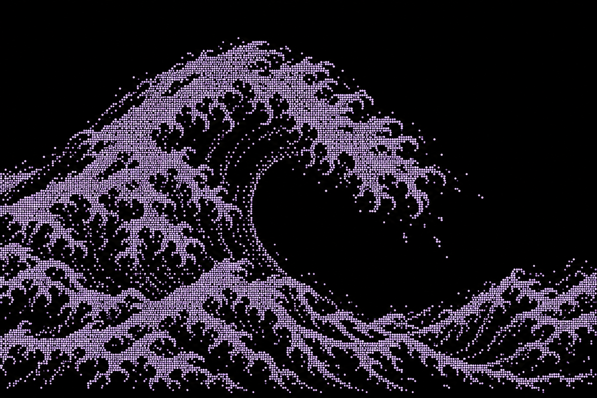

# Approved wave reference

Approved by the user on 2026-10-06: “yes this does. record this as a reference point. start working through wave-process.md”.

Primary composition reference: broad asymmetric rising mass; connected forward-reaching foam crown; irregular downward rakes and unequal forks; large open hollow; layered foreground foam; sparse detached spray. Background and unfoamed water remain black; purple marks represent foam/spray. Interpret the lower streaks as foam on water, not generic water contours.

This is an AI-generated raster concept, produced with the built-in image tool. Approval establishes appearance, not Unicode Braille fidelity, procedural generation, motion, or cliff physics. Do not put this bitmap into the production artwork as a substitute for character rendering. Use exact black #000000 and purple #C5B5EC in implementation, rather than sampling antialiased concept colours.

Original: `exec-a416b66d-bef1-47fc-83bd-5cf1cb1ecbb9.png`, chat `01a10fbd-9f79-7cb1-b5b5-5550b42f9ae1`.

Generation brief: one wide terminal-art snapshot inspired by Hokusai; only foam and spray visible in purple Braille-like dots; a broad asymmetric base, overhanging lip, clustered unequal hooked rakes, lower overlapping formations, and a large empty black hollow. No sky fill, generic water contours, labels, glow, gradients, or repeated comb-like branches.
